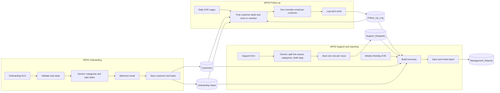

# AI Customer Onboarding, Follow-Up and Support Automation

A three-workflow n8n prototype that onboards a new business customer, keeps them moving with reminders, triages their support questions, and gives management a weekly report. AI drafts and categorises. People stay in charge of anything regulatory, legal or financial.

> **Portfolio prototype**. The sample setting is onboarding exporters, farmers and certifiers onto an agricultural trade platform. All customers and data are fictional, and this project is not affiliated with any company.

- **Built by:** Ilesanmi Imisioluwa Hannah
- **Demo video:** (https://www.loom.com/share/9c093b65de8a492a8e6001ec97763e27)
- **Stack:** n8n, Google Gemini, Google Sheets, Gmail

---

## 1. The problem

Onboarding a business customer is repetitive and easy to drop. Someone has to read the sign-up, work out what the customer needs, send a welcome message, track a list of tasks, chase the ones the customer owns, answer questions, and tell management where things stand. Done by hand, customers stall silently, reminders go to the wrong people, and nobody has a clear picture.

## 2. What it does

| Workflow | Trigger | What it does |
|---|---|---|
| **WF01 Customer Onboarding** | Web form | Validates the sign-up, asks Gemini to categorise the customer and propose 3 to 6 onboarding tasks, emails a personalised welcome, then records the customer and their tasks in Google Sheets |
| **WF02 Customer Follow-Up** | Daily at 9:00 (Lagos) | Finds customer-owned tasks due tomorrow, due today or overdue, sends one reminder email per customer, and logs every send |
| **WF03 Customer Support and Management Reporting** | Support form, plus a weekly schedule | Splits a message into separate issues, categorises each, drafts a reply and flags escalations. Separately, builds a management report, saves it and emails it every Monday at 8:00 |

## 3. Architecture



The workflows do not call each other. They share state through one Google Sheet, which keeps each workflow simple to test and lets a person see and correct the data at any point.

## 4. Workflow detail

### WF01 Customer Onboarding

1. **Form:** business name, contact, email, business type (Exporter, Farmer, Cooperative, Certifier), location, goals, and optional challenges.
2. **Validate:** trims and checks the input and creates a customer ID.
3. **Gemini analysis:** returns a customer category, a needs summary, a personalised plan, clarification questions, and 3 to 6 tasks. Each task has an owner (`CUSTOMER`, `ONBOARDING_TEAM` or `HUMAN_SPECIALIST`) and a priority. Output is forced into a fixed structure.
4. **Welcome email:** tasks are split into "What we need from you" (with a target date) and "What our team will do", so the customer sees only their own actions as theirs.
5. **Save:** the customer row records whether the welcome email was `SENT` or `FAILED`. Tasks are saved with due dates (3, 7 or 10 days by priority).

### WF02 Customer Follow-Up

- Runs daily at 9:00 in Lagos time.
- Reminds a customer **only about tasks they own** that are `PENDING` or `IN_PROGRESS`.
- Three stages of wording: due tomorrow, due today by 5:00 PM, and overdue.
- One email per customer, listing all their tasks. At most one reminder per task per day.
- Writes a `SENT` or `FAILED` row to `Follow_Up_Log` for every task. A failed reminder is retried the next day.

### WF03 Customer Support and Management Reporting

**Support intake (form)**
- One message can contain several questions. Gemini separates them into distinct issues (up to 5), and each becomes its own row with its own category, priority, escalation flag and draft reply.
- Categories come from a fixed list: `ONBOARDING`, `DOCUMENTATION`, `TECHNICAL`, `COMPLIANCE`, `PAYMENT`, `GENERAL`.
- Status is `OPEN`, or `ESCALATED` when the AI says a human decision is needed (regulatory, certification, payment disputes, complaints).
- Drafts are never sent to the customer automatically.

**Management report (weekly, or manual)**
- Totals: customers, customers still onboarding, customers fully onboarded, outstanding tasks, unresolved support requests (and how many are escalated), follow-ups sent and failed.
- A customer counts as fully onboarded when they have tasks and every task is `COMPLETED`.
- The report is saved to `Management_Reports` and emailed to the manager.

## 5. Data model (Google Sheets)

| Tab | Columns |
|---|---|
| `Customers` | customer_id, created_at, business_name, contact_name, email, business_type, country_location, customer_goals, onboarding_challenges, customer_category, needs_summary, onboarding_plan, clarification_questions, onboarding_status, welcome_email_status, last_followup_at (unused) |
| `Onboarding Tasks` | task_id, customer_id, task_title, task_description, responsible_party, due_date, status, created_at, completed_at |
| `Support_Requests` | support_id, customer_id, submitted_at, customer_question, category, priority, ai_draft_response, escalation_required, status, human_response |
| `Follow_Up_Log` | followup_id, customer_id, task_id, sent_at, channel, message, status |
| `Management_Reports` | report_id, generated_at, total_customers, pending_customers, completed_customers, outstanding_tasks, unresolved_support_requests, report_summary |

Status columns have dropdowns and colour coding, dates are shown as `yyyy-mm-dd` and timestamps as `yyyy-mm-dd hh:mm` (Lagos time). `sheet/format_farmily_sheet.gs` applies the formatting in place without changing any column name.

## 6. Reliability and fallbacks

Every failure I could think of has a defined behaviour, and the customer is never left with nothing.

| What can fail | What happens |
|---|---|
| Gemini is unavailable or returns unusable output (WF01) | Retries up to 5 times (5 seconds apart), then continues with a default 3-task plan. The sheet notes that AI was unavailable and the onboarding team reviews manually. The customer is still onboarded |
| Gemini is unavailable or returns unusable output (WF03) | Retries up to 5 times (5 seconds apart), then saves the whole message as one `UNCATEGORISED`, `ESCALATED` row for a human to triage. No question is lost |
| Welcome email fails to send (WF01) | Retries 3 times, then the customer row shows `FAILED` and the onboarding tasks are still created |
| Reminder email fails (WF02) | Retries, then logs a `FAILED` row. Only `SENT` rows suppress a reminder, so it is retried on the next daily run |
| Nothing is due on a given day (WF02) | The run ends quietly with no empty email attempt |
| Google Sheets read or write hiccup | Each Sheets node retries 3 times |
| A task belongs to our team, not the customer | It is never included in a customer reminder |
| A customer message contains several questions (WF03) | Split into one row per issue, so categories and counts stay accurate |
| An empty log or tab on a fresh sheet | Reads tolerate empty tabs, so the first run works |

**A real failure caught in testing:** during testing, Google's Gemini service returned a `503 Service Unavailable` ("high demand"). The workflow retried, then took the fallback path and saved the full three-question message as an escalated, uncategorised row. Nothing was lost and the row clearly asked for manual triage. See `docs/screenshots/gemini-503-fallback.png`.

## 7. Testing

Tested end to end with fictional customers (an exporter, a farmer and a certifier), including a customer who left the optional field blank.

| Area | Check | Result |
|---|---|---|
| WF01 | Three customers onboarded, welcome emails received, customer and task rows created with correct statuses and dates | Passed |
| WF01 | Welcome email shows customer tasks separately from team tasks and does not describe any platform features | Passed |
| WF02 | Tasks set due today and tomorrow produced the right reminder wording, only for customer-owned tasks | Passed |
| WF02 | Reminders logged as `SENT`, and a second run on the same day sent nothing | Passed |
| WF03 | One message with three questions became three rows with separate categories and escalation flags | Passed |
| WF03 | Management report totals matched the sheet, and the email arrived | Passed |
| Failure | Real Gemini 503 outage handled by retry and fallback | Passed |
| Failure | Welcome email failure recorded as `FAILED` with tasks still created | Passed |

Screenshots are in `docs/screenshots/`.

## 8. Design decisions

- **AI drafts, humans decide.** Anything touching regulation, certification, payment or legal questions is escalated, and drafts are never sent without a person. The prompts forbid inventing company policies, fees, features or legal requirements.
- **Fixed lists beat free text.** Categories, priorities and statuses come from short fixed lists, so the sheet can be filtered, coloured and counted reliably.
- **Progress is derived, not typed.** Whether a customer has finished onboarding is worked out from their tasks, so the report cannot drift from reality.
- **Remind only the person who owns the task.** Reminding a customer about something our team must do would erode trust, so reminders are filtered by owner.
- **One sheet as the shared source of truth.** Easy for a non-technical person to inspect, correct and demo.
- **Every failure is visible.** Failures are written to the sheet as `FAILED` or `UNCATEGORISED`, not silently dropped.

## 9. Known limitations

- Support replies are not sent by the system. A person reads the draft and answers the customer, then sets the row to `RESOLVED`.
- There is no duplicate check, so submitting the same business twice creates two customers.
- There is no automatic update of a customer's `onboarding_status` column, because the report derives it from tasks. Task statuses are changed by hand in the sheet.
- The form validation path ends without telling the submitter, because every field is already required by the form.
- It was tested with small fictional data only, not at volume.

## 10. What I would build next as a product manager

1. **Customer feedback to requirements:** pass support questions and replies through AI to produce structured requirement items (customer, problem, impact, suggested requirement, priority) for engineering.
2. **Adoption signals:** track activation milestones, such as first task completed and active after 7 days, to spot stalled customers early.
3. **Success measures to track:** time to first completed task, percentage of customers fully onboarded within an agreed period, reminder-to-completion rate, share of support questions escalated, and time to first human reply.
4. **Approved replies:** an explicit "approved to send" status so a human-reviewed reply can be emailed automatically.

## 11. Setup

1. **Create the Google Sheet** with the five tabs and the exact column names in section 5. Optionally run `sheet/format_farmily_sheet.gs` from Extensions > Apps Script to apply the formatting.
2. **Import the workflows** from `workflows/` into n8n (Workflows > Import from file).
3. **Connect credentials:** Google Sheets (OAuth), Gmail (OAuth) and a Google Gemini API key. Re-select the spreadsheet and tab in each Google Sheets node.
4. **Set the manager email** in the `Email Management Report` node in WF03.
5. **Activate** the workflows. Schedules and live form links only work on an active workflow.
6. **Test** with fictional customers, using addresses you can read.

## 12. Security and privacy

- All customers, businesses and emails in testing are fictional.
- The exported workflow JSON files have the Google Sheet ID, credential IDs and instance ID removed. Credentials are never stored in this repository. You must connect your own.
- No real customer data should be used with this prototype without a privacy review.

## 13. Repository layout

```
README.md
workflows/
  WF01_Customer_Onboarding.json
  WF02_Customer_Follow-Up_Automation.json
  WF03_Customer_Support_and_Management_Reporting.json
sheet/
  format_farmily_sheet.gs
docs/
  screenshots/
test-data/
  fictional_customers.md
```
